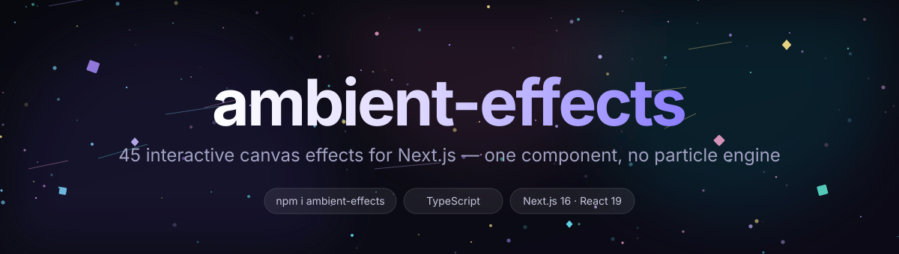

<div align="center">



<br />

**Ambient canvas effects for Next.js pages.** One component, 45 effects, pointer-aware, theme-aware, no particle engine to learn.

[](https://www.npmjs.com/package/ambient-effects)
[](https://www.npmjs.com/package/ambient-effects)
[](LICENSE)
[](https://github.com/Muhammad-waqar-uit/ambient-effects/stargazers)
[](https://nextjs.org)
[](https://www.typescriptlang.org)

[**Live demo**](https://ambient-effects.vercel.app) · [**Documentation**](https://ambient-effects.vercel.app/about) · [**Effects**](#effects) · [**Report a bug**](https://github.com/Muhammad-waqar-uit/ambient-effects/issues/new?template=bug_report.yml) · [**Request an effect**](https://github.com/Muhammad-waqar-uit/ambient-effects/issues/new?template=feature_request.yml)

</div>

---

## Why ambient-effects

- **45 effects, one import.** Fireflies, snowfall, confetti, a starfield, a hacker terminal, Saturn's rings, an emoji storm — all behind a single `<AmbientSurface />`.
- **Feels alive.** Every effect reads pointer position, pointer velocity and scroll, and most react to clicks.
- **Batteries included, dependencies not.** Pure Canvas 2D. No tsParticles, no Three.js, no WebGL context to lose. The only runtime dependencies are `clsx` and `tailwind-merge` for the component's class join.
- **Predictable in production.** Fixed-step loop, DPR capped at 2, `prefers-reduced-motion` respected automatically, per-effect particle arrays reset on resize.
- **Type-safe to the edge.** `EffectId` is a 45-member union — autocomplete every effect, and get a compile error when you typo one.
- **Dark and light.** Every effect has a dark-first palette and a light-mode variant, so it works on a landing page and in a docs site.

## Install

```bash
npm i ambient-effects
```

```bash
pnpm add ambient-effects
# or
yarn add ambient-effects
```

React 19 and Next.js 16 are the tested targets. The component is a client component, so it also works in plain React apps and the App Router alike.

## Quick start

```tsx
"use client";

import { AmbientSurface } from "ambient-effects";

export default function Hero() {
  return (
    <section className="relative h-[100svh] overflow-hidden">
      <AmbientSurface defaultEffect="starfall" fullscreen />
      <h1 className="relative z-10">We shape your dreams</h1>
    </section>
  );
}
```

### Controlled, with your own picker

```tsx
"use client";

import { useState } from "react";
import { AmbientSurface, effects, type EffectId } from "ambient-effects";

export default function Page() {
  const [effect, setEffect] = useState<EffectId>("aurora");

  return (
    <>
      <AmbientSurface effect={effect} onEffectChange={setEffect} showControls={false} fullscreen />
      <select value={effect} onChange={(e) => setEffect(e.target.value as EffectId)}>
        {effects.map((e) => (
          <option key={e.id} value={e.id}>{e.name}</option>
        ))}
      </select>
    </>
  );
}
```

### Grouped selector

Effects declare a `group` (`Presets`, `Classic`, `Cosmic`, `Digital`, `Playful`) so you can build sectioned menus without hardcoding lists:

```tsx
import { effects, type EffectGroup } from "ambient-effects";

const groups = ["Presets", "Classic", "Cosmic", "Digital", "Playful"] as const;

export function Picker({ onPick }: { onPick: (id: EffectId) => void }) {
  return groups.map((group: EffectGroup) => (
    <div key={group}>
      <h3>{group}</h3>
      {effects.filter((e) => e.group === group).map((e) => (
        <button key={e.id} onClick={() => onPick(e.id)}>{e.name}</button>
      ))}
    </div>
  ));
}
```

## Effects

45 effects in five groups. The **Presets** group re-creates the full [tsParticles preset catalogue](https://github.com/tsparticles/tsparticles) — same visual language, written from scratch for this package.

### Presets (20)

| Effect | `id` | What it does |
| --- | --- | --- |
| Ambient | `ambient` | Slow drifting dots with soft glow, the calm default background. |
| Big Circles | `big-circles` | Large translucent discs that overlap and drift. |
| Bubbles | `bubbles` | Rising soap bubbles; click near one to pop it into droplets. |
| Confetti | `confetti` | Rotating confetti pieces that scatter away from the pointer. |
| Confetti Cannon | `confetti-cannon` | Confetti fired from the bottom corner; click fires a burst at the pointer. |
| Confetti Explosions | `confetti-explosions` | Periodic radial confetti explosions; click anywhere to detonate. |
| Confetti Falling | `confetti-falling` | Dense slow confetti rain with tumble and sway. |
| Confetti Parade | `confetti-parade` | Wide ribbons of confetti marching across the canvas. |
| Fire | `fire` | Layered hot-core flames with embers rising and flickering. |
| Fireflies | `fireflies` | Glowing insects that wander, blink and lean toward the cursor. |
| Fireworks | `fireworks` | Rockets climb, then burst into gravity-affected sparks; click launches. |
| Fountain | `fountain` | A central water jet arcing into droplets that fall back. |
| Hyperspace | `hyperspace` | Star streaks accelerating outward from the centre into warp lines. |
| Links | `links` | Node network where nearby particles connect with lines. |
| Matrix | `matrix` | Digital rain of mutating glyphs with a bright falling head. |
| Sea Anemone | `sea-anemone` | Radial tentacles waving in a current, drawn as single two-pass strokes. |
| Snow | `snow` | Layered snowfall with wind drift, cursor repulsion and scroll gusts. |
| Squares | `squares` | Grid of squares that pulse, rotate and scatter. |
| Stars | `stars` | Falling purple stars with cursor repulsion; click drops a shower. |
| Triangles | `triangles` | Drifting triangles with varied rotation and opacity. |

### Classic (10)

| Effect | `id` | What it does |
| --- | --- | --- |
| Constellation | `constellation` | Stars linked by lines, with extra lines reaching to your cursor. |
| Stardust | `stardust` | Sparkling dust whose trails follow fast pointer movement. |
| Embers | `embers` | Rising glowing embers, brighter near the bottom of the canvas. |
| Leaves | `leaves` | Falling leaves with rotation, sway and mid-air tumbling. |
| Rain | `rain` | Heavy rain that pools into ripple rings at varying landing heights; click splashes. |
| Flow | `flow` | Silky particle trails swirling around a cursor vortex. |
| Spooky | `spooky` | Halloween lantern scene: cursor-carved darkness, drifting ghosts, blinking eyes and lightning. |
| Neon | `neon` | Flickering neon circuit strokes that glow brighter near the cursor. |
| Wind | `wind` | Gusting streaks that swirl around the pointer and follow scroll velocity. |
| Sunlight | `sunlight` | Warm god-rays, floating dust motes and scroll-slanted haze. |

### Cosmic (8)

| Effect | `id` | What it does |
| --- | --- | --- |
| Aurora | `aurora` | Shimmering aurora curtains with ray structure that warps near the cursor. |
| Nebula | `nebula` | Volumetric clouds with embedded stars, slowly rotating. |
| Starfall | `starfall` | Moving starfield + purple drops that streak down, splash into rings, and glow the floor. Click drops a pair. |
| Star Drops | `star-drops` | Just the purple droplets: falling, splashing, rippling. Click to drop one. |
| Night Sky | `night-sky` | Just the sky: parallax stars drifting and twinkling over a static field. |
| Space Rocks | `space-rocks` | Asteroids tumbling in from depth with craters, dust trails and parallax. |
| Saturn Ring | `saturn-ring` | A ringed planet slowly rotating, ring particles orbiting in perspective. |
| Cosmic Planets | `cosmic-planets` | A system of planets on elliptical orbits with moons and a central star. |

### Digital (4)

| Effect | `id` | What it does |
| --- | --- | --- |
| Glitch | `glitch` | RGB-split signal with real slice displacement, scanlines and noise bursts. Click to tear the frame. |
| Hacker | `hacker` | Falling green katakana + hex columns with a glowing head and terminal scanlines. |
| Music Bars | `music-bars` | Equalizer bars with mirrored reflections and peak caps. Click to pulse the beat. |
| Radio Glitch | `radio-glitch` | Oscilloscope waveform with static bursts and frequency jumps. Click to retune. |

### Playful (3)

| Effect | `id` | What it does |
| --- | --- | --- |
| Petals | `petals` | Tumbling blossom petals with curl and sway. |
| Ripple | `ripple` | Water rings expanding from time, pointer speed and clicks. |
| Emoji | `emoji` | Floating emoji confetti that spins, drifts and reacts to the pointer. Click to spawn more. |

> The `/about` page in this repo renders the full catalogue with descriptions and props, and the demo at `/` has a searchable sidebar covering all 45.

## Interactions

| Input | Behaviour |
| --- | --- |
| **Move** | Effects read smoothed pointer position and velocity. Many push, pull or swirl particles around the cursor. |
| **Click** | Bursts of sparks at the pointer plus a radial shove. Effect-specific clicks: bubble pops, firework launches, starfall drops, glitch tears, beat pulses. |
| **Scroll** | Scroll velocity slants motion; wind follows the sine of scroll progress. |
| **Arrow keys** | `ArrowRight` / `ArrowLeft` cycle effects (when controls are enabled). |
| **Theme toggle** | `dark` swaps palettes and re-initialises the active effect. |

## Props

`<AmbientSurface />` accepts:

| Prop | Type | Default | Description |
| --- | --- | --- | --- |
| `defaultEffect` | `EffectId` | `"fireflies"` | Initial effect for the uncontrolled component. |
| `effect` | `EffectId` | — | Controlled effect. Passing it makes the component fully controlled. |
| `onEffectChange` | `(id: EffectId) => void` | — | Called whenever the effect changes (select, arrows, `setEffect`). |
| `showControls` | `boolean` | `true` | Renders the built-in picker in the top-right corner. |
| `fullscreen` | `boolean` | `false` | Sizes the canvas to the viewport instead of its container. |
| `dark` | `boolean` | `true` | Dark-first palette. Toggling re-inits the effect. |
| `reduceMotion` | `boolean` | `undefined` | When unset, follows `prefers-reduced-motion`; `true` halves particle density. |
| `className` | `string` | — | Extra classes for the wrapper element. |
| `style` | `CSSProperties` | — | Inline styles for the wrapper element. |

The wrapper is `position: relative` and fills its parent, so give the parent a height:

```tsx
<div className="h-[60vh]">
  <AmbientSurface defaultEffect="nebula" showControls={false} />
</div>
```

### Exports

```ts
import {
  AmbientSurface,   // the component
  effects,          // EffectDefinition[] — 45 entries with id, name, group, hue
  getEffect,        // (id: string) => EffectDefinition
  type EffectId,    // 45-member union
  type EffectGroup, // "Presets" | "Classic" | "Cosmic" | "Digital" | "Playful"
  type EffectProps, // the draw-function contract
  type AmbientSurfaceProps,
} from "ambient-effects";
```

Also exported for custom UIs: `spawnBurst`, `drawBursts`, `clearBursts`, `pushParticles`, `resetEffect`, and the `cn` class helper.

## Theming

Effects only draw; the surface owns the background. In dark mode the canvas backdrop is near-black, in light mode near-white, and each effect shifts its palette accordingly. To sit an effect over a coloured section, pass `className` and let the canvas be transparent-ish:

```tsx
<AmbientSurface defaultEffect="petals" dark={false} className="mix-blend-screen" />
```

## Accessibility & performance

- **Reduced motion** is respected via `matchMedia("(prefers-reduced-motion: reduce)")`; density halves instead of freezing, so the page still feels alive.
- **DPR is capped at 2** — crisp on retina, no 3× fill-rate cliff on 4K displays.
- **Fixed timestep** (`time += 1/60`) keeps motion identical at 60, 120 and 144 Hz.
- **One canvas, one rAF loop.** Switching effects reuses the same surface and resets only that effect's particle array.
- **No layout thrash.** The canvas is absolutely positioned inside a `relative` wrapper; resizes are observed, not polled.

If you need to pause on tab-hidden pages, that's handled by `requestAnimationFrame` itself. For very long pages, mount the surface only where it's visible.

## Demo

The repo ships a full demo app:

```bash
git clone https://github.com/Muhammad-waqar-uit/ambient-effects
cd ambient-effects
npm install
npm run dev
```

- `/` — searchable sidebar with all 45 effects, grouped, plus a light/dark toggle.
- `/about` — install docs, props, effect catalogue.

## Scripts

| Script | Purpose |
| --- | --- |
| `npm run dev` | Next.js dev server with the demo app. |
| `npm run build` | Production build (also verifies the library compiles). |
| `npm run start` | Serve the production build. |
| `npm run lint` | ESLint via `eslint-config-next`. |
| `npx tsc --noEmit` | TypeScript strict-mode check. |

## Project structure

```
src/
├── index.ts                    # public barrel: component, effects, types
├── lib/
│   ├── utils.ts                # cn() helper
│   └── ambient/
│       ├── types.ts            # EffectId, EffectGroup, EffectProps, ...
│       ├── ambient-surface.tsx # "use client" canvas + interaction layer
│       └── effects.ts          # all 45 effect implementations
├── app/                        # demo app (/, /about)
└── components/ui/              # demo-only UI primitives
docs/banner.svg                 # README banner
```

## Contributing

Contributions are welcome — especially new effects, palette improvements and browser-performance fixes.

1. Read [CONTRIBUTING.md](CONTRIBUTING.md).
2. Follow the [Code of Conduct](CODE_OF_CONDUCT.md).
3. Run the gates before opening a PR: `npx tsc --noEmit && npm run lint && npm run build`.
4. Add your effect to the tables above and to [CHANGELOG.md](CHANGELOG.md).

Found a security issue? Please follow [SECURITY.md](SECURITY.md) instead of opening a public issue.

## License

[MIT](LICENSE) © ambient-effects contributors
